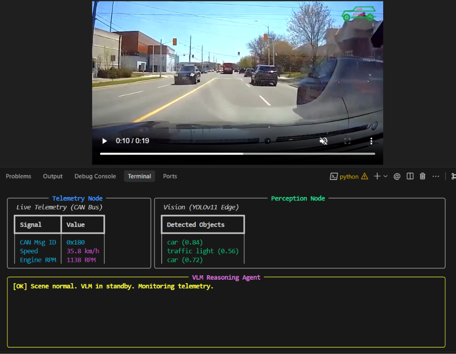
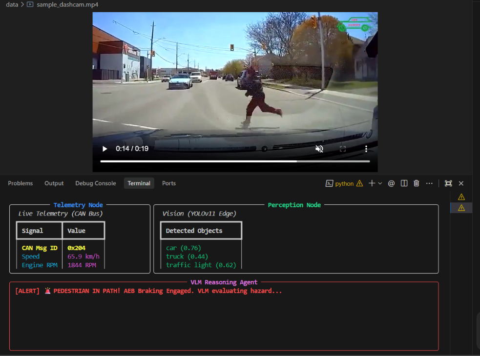
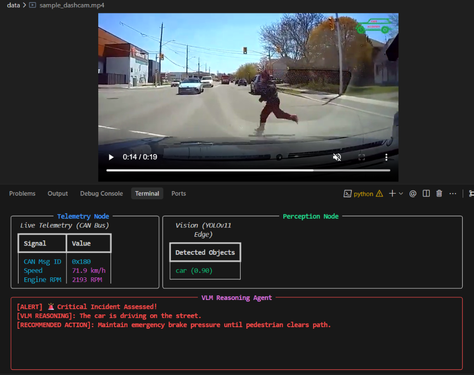

# DriveSense 🚗⚡

DriveSense is a terminal-based **Multimodal AI Agent for Predictive Automotive Diagnostics and Scene Understanding**. It operates as an intelligent edge system fusing synchronized dashcam video streams with CAN bus telemetry data to detect hazards in real-time and provide human-interpretable VLM explanations.

---

## 📸 Demo & Screenshots

### 1. Normal Operation (Edge Standby)
YOLOv11 detects road participants in real time while CAN telemetry monitors vehicle speed, steering, and braking. The high-compute Vision-Language Model (VLM) stays in standby mode to preserve edge resources.

<p align="center">
  
</p>

### 2. Hazard Anomaly & AEB Alert
When an unexpected hazard occurs (e.g., pedestrian stepping into the road) or sudden severe deceleration is detected on the CAN bus, DriveSense immediately raises a critical alert and triggers the VLM reasoning engine.

<p align="center">
  
</p>

### 3. Multimodal VLM Reasoning & Decision Support
The VLM analyzes the exact incident frame coupled with the CAN telemetry telemetry history, producing contextual reasoning and recommending safety actions.

<p align="center">
  
</p>

---

## 🏗️ System Architecture

- **Perception Node:** Real-time object detection via **YOLOv11** (Nano edge model for high FPS).
- **Telemetry Node:** Virtual CAN bus replay and message parsing (speed, engine RPM, steering angle, brake pressure).
- **Reasoning Agent (VLM):** Multimodal scene evaluation using local **Ollama** (`moondream` / local vision models) triggered dynamically upon anomalies.
- **Terminal UI:** Live, non-blocking dashboard rendered using **Rich**.

---

## 🚀 Getting Started

### Prerequisites
- Python 3.10+
- *(Optional for live local VLM inference)*: [Ollama](https://ollama.com/) with `ollama pull moondream`. If Ollama is not running, DriveSense automatically falls back to graceful simulated reasoning.

### Installation

1. **Clone the repository:**
   ```bash
   git clone https://github.com/wassmigh/DriveSense.git
   cd DriveSense
   ```

2. **Create and activate a virtual environment:**
   ```bash
   python -m venv venv
   # Windows (PowerShell):
   .\venv\Scripts\Activate.ps1
   # Linux/macOS:
   source venv/bin/activate
   ```

3. **Install dependencies:**
   ```bash
   pip install -r requirements.txt
   ```

---

## 🖥️ Running the Dashboard

Launch the synchronized simulation dashboard:
```bash
python run_drive_sense.py
```

Press `Ctrl+C` in the terminal to exit the live simulation.
